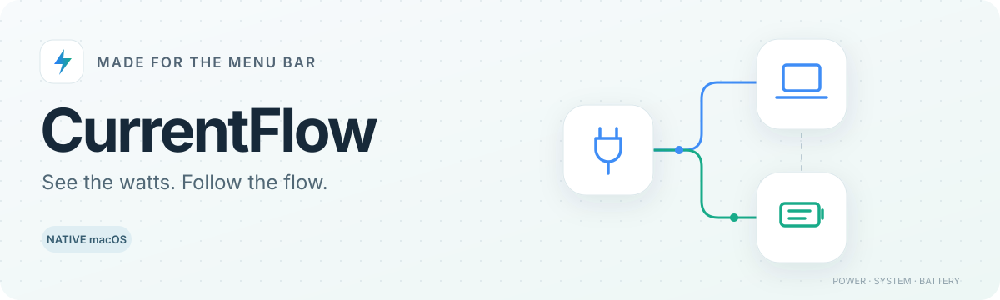
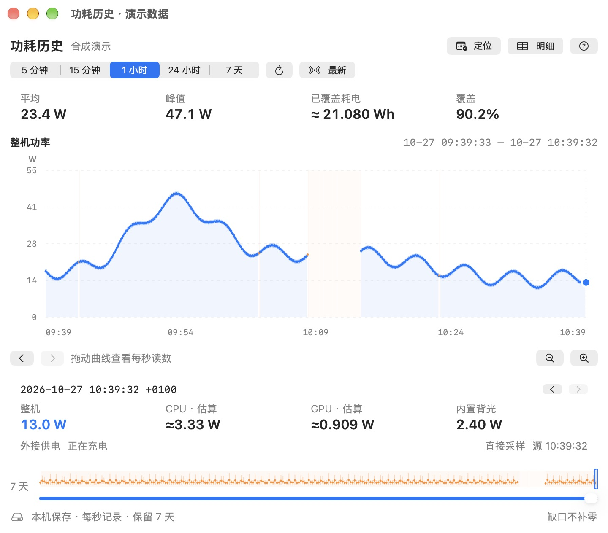
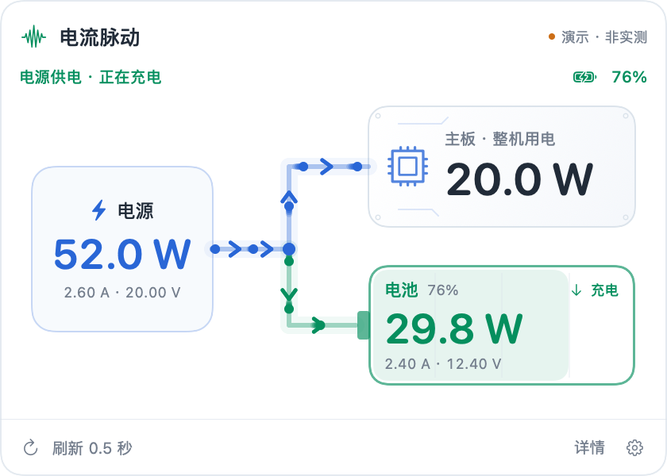
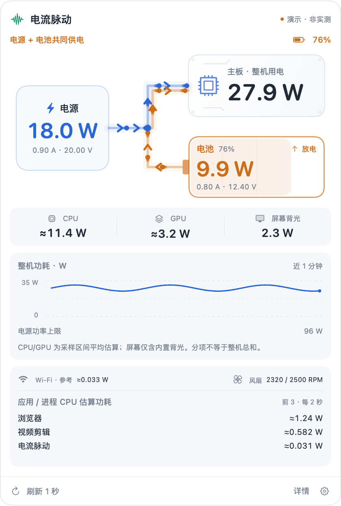

<div align="center">



# CurrentFlow · 电流脉动

**See the watts. Follow the flow.**

[**Download for Mac ↗**](https://github.com/kyox215/CurrentFlow/releases/latest) · [中文](README.md) · [Changelog](CHANGELOG.md) · [MIT](LICENSE)

`macOS 13+` · `Apple Silicon` · `SwiftUI` · `Local only`

</div>

A native SwiftUI menu bar app with a compact 420pt-wide light panel. Live system watts appear directly in the menu bar. The panel connects three nodes: power input on the left, system board at the upper right, and battery at the lower right. Watts take priority; amps and volts are secondary.

---

**Latest: [v0.10.0](https://github.com/kyox215/CurrentFlow/releases/tag/v0.10.0).** Record power locally at second resolution and explore the last seven days in a compact graphical history window. Its default size is 720 × 600; summary metrics, the chart, cursor and time controls stay together, with the overview in a popover at shorter heights. [Download and introduction](https://www.chinatech.in/currentflow) · [Chinese update copy](docs/updates/0.10.0.zh-CN.txt).



The history screenshot uses synthetic demo data, including a visible gap.




<details>
<summary>Details preview (demo data)</summary>



</details>

## Features

- Compact, content-sized menu bar watts with a 16pt icon; live input, battery and whole-system power readings.
- CPU/GPU average watts and internal display-backlight watts in one row; unavailable or stale readings show a dash.
- Directional animations for charging, discharging and combined adapter/battery supply.
- Details-only Wi-Fi reference watts, actual fan RPM and top-three app/process CPU estimates; process scans run every two seconds only while Details is visible.
- Adjustable 0.5–300 second sampling, with saved preferences.
- Launch at login through macOS `SMAppService`, with approval status and a System Settings shortcut.
- Silent menu bar startup, with an optional “show panel on launch” setting.
- Details expand the panel automatically, showing a one-minute whole-system power chart in watts and adapter power limit. Collapse restores the compact panel.
- Notch-aware positioning, scrolling when screen space is limited, and reduced-motion support.
- Local-only operation: no account, network requests, telemetry, root access or additional driver.

## Install

Prebuilt packages target **Apple Silicon and macOS 13 or later**.

Download a DMG or ZIP from [chinatech.in](https://www.chinatech.in/currentflow) or [Releases](https://github.com/kyox215/CurrentFlow/releases/latest), move `电流脉动.app` into Applications, and open it there. Click its menu bar icon or watt reading to open the panel.

The release is **ad-hoc signed and not Developer ID notarized**. macOS may report an unidentified developer. You can inspect the source and build locally instead. Release checksums are provided.

The gear menu contains “开机自启” (launch at login) and “启动时展开面板” (show panel on launch). Both default to off. Enable the first and leave the second off for silent login startup. macOS may require approval in Login Items; the app reports this rather than pretending approval has already been granted. The first launch opens the panel once.

## Reading the diagram

Blue carries external power to the system. Green flows into the battery. Orange flows out of the battery toward the system. The board node displays **whole-system power**, not a separately measured motherboard rail.

Readings are DC measurements inside the Mac, not AC wall-outlet measurements. Input and battery currents use different voltage domains and cannot be subtracted directly. Independent sensor updates may make instantaneous power values differ. An idle battery can legitimately remain at zero.

The app reads eight allowlisted AppleSMC keys (`B0AC`, `B0AV`, `ID0R`, `VD0R`, `PDTR`, `PSTR`, `PBwo`, `PDBR`) and reads `wiPm`, `F0Ac`, `F1Ac` only while Details is visible. Power readings fall back to IOKit properties. It contains no SMC write, fan-control or charging-control path. These hardware fields are not a stable public Apple contract; unsupported readings remain unavailable or are clearly labeled as cached/estimated. Sampling faster does not force hardware to update faster.

CPU/GPU watts are computed from aggregate IOReport energy-counter deltas divided by actual elapsed time. They are marked `≈` as interval-average model estimates. Known CLPC report IDs are used only on macOS 27.0/27.0.1; unknown versions/drivers are not guessed. Display power covers the internal backlight, not the entire display module or external monitors. These components do not sum to whole-system watts. See [third-party notices](THIRD_PARTY_NOTICES.txt).

Wi-Fi is a reference sensor value: on the tested Mac it stayed near 0.033 W during a 4 MB Wi-Fi transfer, so it is not presented as an accurate live wireless power measurement. App/process rankings use `rusage_info_v6.ri_energy_nj` deltas as CPU-side average estimates, aggregate app Helpers, and do not represent total app energy. Closing Details stops process scans; reopening establishes a fresh baseline.

## Build and verify

Requires macOS, Xcode / Command Line Tools and Swift 5.9+. No third-party dependencies.

```sh
git clone https://github.com/kyox215/CurrentFlow.git
cd CurrentFlow
bash scripts/build.sh
bash scripts/test.sh
```

The app is written to `build/电流脉动.app`; ZIP and DMG packages go into `artifacts/`. The script targets the host architecture. Intel and other hardware have not been comprehensively tested.

```sh
build/电流脉动.app/Contents/MacOS/CurrentFlow --snapshot
build/电流脉动.app/Contents/MacOS/CurrentFlow --process-power
build/电流脉动.app/Contents/MacOS/CurrentFlow --startup-status
build/电流脉动.app/Contents/MacOS/CurrentFlow --render-preview artifacts
```

The core checks cover parsing, sensors, fallback behavior, layout, sampling, startup settings and second-resolution history. Use the focused history and window scripts for those interactions. Check counts and pass/fail status belong to the actual run logs. Physical reboot, seven-day on-device endurance and broader hardware support still need verification in the relevant environments.

Screenshots and animations in `docs/` use labeled demo data. See [CONTRIBUTING](CONTRIBUTING.md) before reporting compatibility issues; do not post battery serial numbers or full IORegistry dumps.

## License

[MIT](LICENSE) © 2026 kyox215.

## Second-resolution power history

Details → Power history opens 5-minute, 15-minute, 1-hour, 24-hour and 7-day ranges. Collection continues with the panel closed and is independent of the display refresh setting; at most one raw observation is saved per second. SQLite stores the latest rolling 604,800 seconds locally in `~/Library/Application Support/CurrentFlow/history.sqlite3`. Long charts query at most 600 aggregate buckets; exact lookup loads eleven nearby seconds. Dates include a UTC offset to distinguish repeated daylight-saving hours.

W is power; Wh integrates only valid adjacent observations within one uninterrupted session, using their actual elapsed time. Missing seconds, stale/invalid readings, sleep, restarts and clock changes break integration. Blue chart buckets are complete, orange buckets contain gaps, and blank areas have no valid power. Totals cover only the measured intervals, never the entire period when gaps exist. Second-level resolution does not imply sensor accuracy; existing cache/reference/estimated labels apply. Unavailable or >2-second-old power is NULL, never fabricated as zero. Demo observations are excluded. No recording occurs while asleep or after exit. Sampling prevents App Nap throttling while allowing normal system sleep, so slow display refresh still incurs one-second sensor collection overhead. Normal quit awaits the pending write; forced termination or power loss can lose the last in-flight record.

Build an isolated review bundle with `bash scripts/build-history-candidate.sh`. The script prints the isolated `/private/tmp/currentflow-history-candidate.XXXXXXXX/CurrentFlow History.app` path; an optional output directory can be supplied (use a normal local directory to avoid File Provider signing metadata). It uses its own bundle ID/preferences and `CurrentFlow-History-Candidate` Application Support directory. `--history-directory /absolute/path` selects a separate database folder; `--history-window` opens the history window. The installed app is unaffected.

The graphical history explorer adds 5/15-minute quick ranges, cursor-centered zoom down to 15 seconds, half-window panning, a draggable seven-day overview, and exact-second cursor readings. Hover/click/drag, arrow keys and accessibility actions share one bounded navigation state. Inspecting an older period pauses live following; refresh stays in that period and Return to latest explicitly resumes it. A compact summary row shows a sample-weighted mean, peak, measured energy and valid-data coverage. Exact-time entry and nearby-second details open on demand in popovers. Incomplete buckets are isolated and gaps are never connected. The page supports light/dark appearance, defaults to 720 × 600 and allows a minimum of 600 × 500. Shorter windows move the seven-day overview into a popover. UI reads are debounced, bounded, cancelled on close/minimize, and stale results cannot replace newer selections. Raw sampling and retention remain unchanged. Run `bash scripts/test-history-ui.sh` for focused state/async regression checks and `bash scripts/preview-history.sh` for a labelled, isolated synthetic-data native preview.
