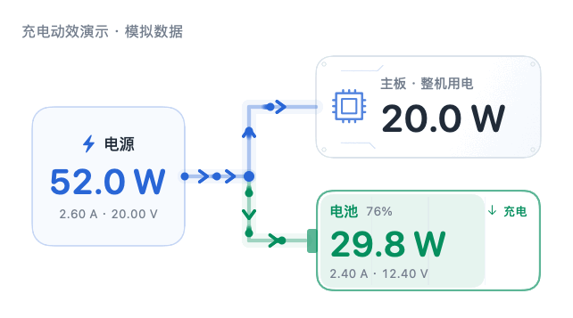
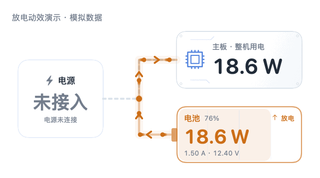

# 电流脉动 · CurrentFlow

**一眼看懂 Mac 的实时功耗，以及电源、电池与电脑之间的供电流向。**

原生 SwiftUI 菜单栏应用，白色主题、420 × 300 的紧凑面板。菜单栏直接显示整机实时功耗，例如 `23.4W`；展开后，左侧电源、右上主板、右下电池通过带方向的流动动画连接。功率 W 用大字，电流 A 和电压 V 用小字，读数分清主次。

[English](README.en.md) · [下载最新版](https://github.com/kyox215/CurrentFlow/releases/latest) · [更新记录](CHANGELOG.md) · [MIT 许可证](LICENSE)


> 预览图和动图使用明确标注的演示数据。安装后的 App 默认读取真实硬件。

## 主要功能

- **实时功耗**：菜单栏以小图标和紧凑 W 数显示整机功耗，宽度随文字调整；面板同时展示电源输入与电池充放电功率。
- **供电流向动画**：蓝色表示外接电源供电，绿色表示充入电池，橙色表示电池向电脑供电；支持共同供电状态。
- **电流和电压**：A/V 作为辅助信息，缺失读数显示 `—`，估算值有标注。
- **可调刷新**：预设 0.5、1、2、5、10、30、60 秒，也可自定义 0.5–300 秒，重启后保留。
- **开机自启**：接入 macOS 登录项管理，可在 App 中开关，也可打开系统登录项设置。
- **静默启动**：默认后续启动只驻留菜单栏；可单独开启“启动时展开面板”。
- **按需展开**：点击“详情”自动增高，查看近一分钟整机功耗 W 趋势和电源功率上限；点击“收起”恢复紧凑面板。
- **紧凑与避让**：窗口避开刘海和屏幕边缘，屏幕空间不足时可在面板内滚动。
- **本地运行**：无账号、网络请求、广告或遥测；不需要 root 或额外驱动。

<details>
<summary>查看充电与放电动效</summary>

充电：



电池供电：



</details>

## 下载与安装

发布包适用于 **Apple Silicon（M 系列芯片）和 macOS 13+**。

1. 在 [Releases](https://github.com/kyox215/CurrentFlow/releases/latest) 下载 `.dmg` 或 `.zip`。
2. 将 `电流脉动.app` 放入“应用程序”，从那里打开。
3. 点击屏幕顶部菜单栏的电脑图标或 W 数，查看供电面板。

发布包使用 **本地 ad-hoc 签名，未做 Apple Developer ID 公证**，macOS 可能提示开发者尚未验证。可检查源码后自行构建。完整校验和随 Release 提供。

### 开机自启与静默启动

点击面板右下角齿轮：

- 勾选 **开机自启**，应用会在当前用户登录 macOS 后启动；默认关闭。
- 保持 **启动时展开面板** 未勾选，即可只显示菜单栏。
- 如果显示“等待系统允许”，点击系统设置入口，在 macOS 登录项中允许该 App。

请先安装到“应用程序”，再开启自启。首次打开会展开一次面板，便于找到应用。开关依据系统实际状态显示；在系统设置中关闭后，App 不会自行重新启用。

## 读数如何理解

| 位置 | W 数含义 | 辅助信息 |
| --- | --- | --- |
| 电源 | Mac 输入端的直流功率 | 输入电流 A、电压 V |
| 主板节点 | **整台电脑的功耗**，不是主板单独的电源轨 | 估算值会标注 |
| 电池 | 电池端充入或放出的功率大小 | 电流 A、电压 V、电量与方向 |

这些不是墙上插座侧的交流读数。电源与电池处于不同电压域，安培数不能直接相减。电池待机时保持 `0W` 或 `0A` 是正常状态；稳定的真实读数不会被人为加入变化。

应用优先只读访问 AppleSMC 的 `B0AC`、`B0AV`、`ID0R`、`VD0R`、`PDTR`、`PSTR`，回退到 IOKit 电源属性。SMC 只实现键元数据查询和读取，**不写传感器、不控制风扇、不修改充电策略**。硬件字段不属于 Apple 稳定的公开接口契约，不同机型或系统可能缺失；缓存来源和采样时间会显示在面板内。

不同传感器可能在不同时刻更新，因此瞬间的输入功率、电池功率和整机功耗可能不能精确相加。刷新间隔表示 App 的采样频率，不保证硬件以相同频率更新。

## 从源码构建

需要 macOS、Xcode / Command Line Tools 和 Swift 5.9+，无第三方依赖。

```sh
git clone https://github.com/kyox215/CurrentFlow.git
cd CurrentFlow
bash scripts/build.sh
```

输出为 `build/电流脉动.app`，ZIP 与 DMG 安装包位于 `artifacts/`。

构建脚本按本机架构编译，在临时目录生成图标、签名与安装包。公开预编译版本仅为 Apple Silicon；Intel 机型和其他硬件尚未全面验证。

### 检查与预览

```sh
bash scripts/test.sh
build/电流脉动.app/Contents/MacOS/CurrentFlow --snapshot
build/电流脉动.app/Contents/MacOS/CurrentFlow --startup-status
build/电流脉动.app/Contents/MacOS/CurrentFlow --render-preview artifacts
```

当前包含 **157 项检查**，覆盖数据解析、传感器解码、缓存回退、功率推算、窗口安全区域、详情展开和收起、刷新和趋势、后台采样及登录项状态处理。运行中的登录项注册/注销、启动偏好保存与静默冷启动也已在本机验证；没有为验证而实际注销或重启 macOS。

## 项目结构

| 路径 | 内容 |
| --- | --- |
| `Sources/` | SwiftUI 界面、AppKit 菜单栏与窗口、硬件读取和登录项设置 |
| `Tests/` | 解析、布局、采样、刷新与启动行为检查 |
| `scripts/` | 构建、图标生成与测试脚本 |
| `Resources/` | 随 App 打包的使用说明 |
| `docs/` | 使用演示数据生成的预览和动图 |

欢迎提交 [Issue](https://github.com/kyox215/CurrentFlow/issues) 或 Pull Request，见 [贡献指南](CONTRIBUTING.md)。报告硬件兼容性时请提供 macOS 版本、芯片型号和数据来源标注，不要上传电池序列号或完整 IORegistry 导出。

参考：[Apple 电源信息 API](https://developer.apple.com/documentation/iokit/1523839-iopscopypowersourcesinfo)、[Apple 登录项管理](https://developer.apple.com/documentation/servicemanagement/smappservice)、[Stats 传感器定义](https://github.com/exelban/stats/blob/master/Modules/Sensors/values.swift)、[SMC 协议资料](https://github.com/hholtmann/smcFanControl/blob/master/smc-command/smc.h)。

## 许可证

[MIT](LICENSE) © 2026 kyox215。
